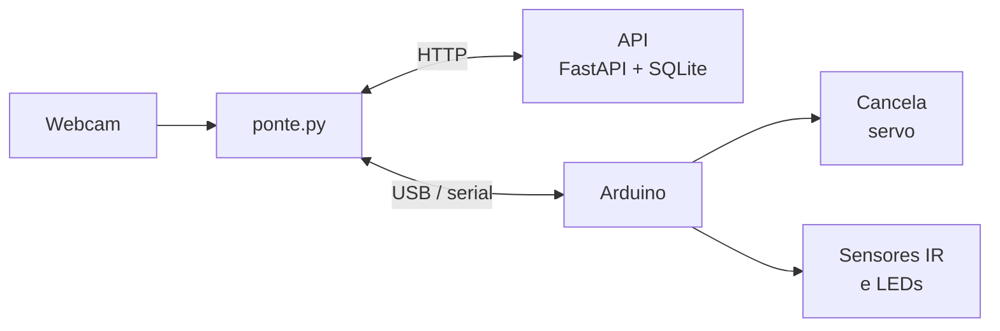

# InoVision-estacionamento-inteligente

Arquivos de código referentes ao projeto final de Programação Web 3.0 e Inteligência Artificial Aplicada do ano de 2026.2.

O sistema hardware-software consiste em um estacionamento com 3 vagas e uma cancela. Uma webcam lê a placa do carro, uma IA (MLP) transforma a imagem em texto, uma API decide se a cancela abre e um Arduino controla a cancela, os sensores e os LEDs das vagas.

## Como funciona



1. O **ponte.py** pega a imagem da webcam e a IA lê a placa (ex.: ABC1D23).
2. Ele envia a placa para a API, que responde se a cancela deve **abrir** ou **recusar** (e se é entrada ou saída).
3. Se for "abrir", o **ponte.py** manda o comando ABRIR para o Arduino, que levanta a cancela por 3 segundos.
4. Quando um sensor de vaga muda, o Arduino avisa o PC (VAGAS:010) e o **ponte.py** repassa para a API.

## O que você precisa

- Python 3.10 ou mais recente
- Arduino Uno + cabo USB
- Webcam (pode ser a do notebook ou uma USB)
- 3 sensores infravermelhos (tipo FC-51), 1 servo motor, 3 LEDs verdes, 3 LEDs vermelhos e 6 resistores
- Arduino IDE instalado

## Montagem do circuito

| Componente | Pino do Arduino |
|---|---|
| Servo (fio de sinal) | 9 |
| Sensor IR da vaga 1 / 2 / 3 (pino OUT) | 2 / 3 / 4 |
| LED verde da vaga 1 / 2 / 3 | 5 / 7 / 10 |
| LED vermelho da vaga 1 / 2 / 3 | 6 / 8 / 11 |

Os sensores IR, o servo e os LEDs (pelo resistor) também vão no **5V** e no **GND** do Arduino.

---

## Como rodar o projeto

#### Passo 1: Baixar o projeto

```bash
git clone https://github.com/beatrizfariasilvaa/InoVision-estacionamento-inteligente.git
cd InoVision-estacionamento-inteligente
```

#### Passo 2: Criar o ambiente virtual e instalar as bibliotecas

```bash
python -m venv venv
venv\Scripts\Activate.ps1
pip install opencv-python numpy scikit-learn joblib pillow pyserial requests fastapi uvicorn sqlalchemy
```

#### Passo 3: Gravar o programa no Arduino

O arquivo **cancela.ino** roda dentro do Arduino, e não no computador. Por isso ele precisa ser gravado na placa:

1. Plugue o Arduino no USB.
2. Abra o arquivo **arduino/cancela.ino** na Arduino IDE.
3. Escolha "Arduino Uno". 
4. No menu Ferramentas, vá em Porta e escolha a porta do Arduino (ex.: COM3).
5. Clique em "Carregar" (botão com a seta).

Isso só precisa ser feito uma vez. O programa fica salvo no Arduino mesmo depois de desplugar.

> Depois de gravar, feche a Arduino IDE. Se ela ficar aberta, ocupa a porta e o sistema não consegue falar com o Arduino.

#### Passo 4: Ligar a API (terminal 1)

Abra um terminal na pasta do projeto e rode:

```bash
venv\Scripts\Activate.ps1
cd api
uvicorn main:app
```

Deixe esse terminal aberto. A API fica rodando em **http://localhost:8000**.

#### Passo 5: Ligar a ponte (terminal 2)

Com o Arduino e a webcam plugados, abra outro terminal na pasta do projeto e rode:

```bash
venv\Scripts\Activate.ps1
cd visao
python ponte.py
```

O programa usa a webcam número 1 e o Arduino na porta COM7 (se no seu computador forem outros, troque `CAMERA` em `visao/camera.py` e `PORTA` em `visao/serial_arduino.py`), e abre uma janela com a imagem da câmera. A partir daí, é só mostrar a placa para a câmera.

No terminal aparecem mensagens como:

```
Vagas: 010
Placa ABC1D23: abrir (entrada) - Entrada autorizada. Vaga disponível.
```

Para sair, clique na janela da webcam e aperte **Q**.

#### Passo 6: Ver o estado do sistema

Abra no navegador: **http://localhost:8000/docs**

| Rota | O que mostra/faz |
|---|---|
| GET /vagas | Quais vagas estão ocupadas |
| GET /veiculos | Carros estacionados agora + últimos registros |
| DELETE /veiculos | Zera o banco |

---

## Regras do estacionamento

- **Entrada:** placa válida, que não está no estacionamento, e com vaga livre. A cancela abre.
- **Saída:** placa que já está no estacionamento. A saída é registrada e a cancela abre.
- **Recusa:** placa inválida ou estacionamento lotado (3/3). A cancela fica fechada.
- Depois de cada leitura, o sistema espera 10 segundos antes de ler outra placa, para o mesmo carro não ser contado duas vezes.


## Extra: testar só a câmera e a IA (sem Arduino e sem API)

```bash
venv\Scripts\Activate.ps1
cd visao
python teste_camera.py
```

- Aponte a webcam para a placa e aperte **ESPAÇO** para ler.
- Aperte **Q** para sair.

